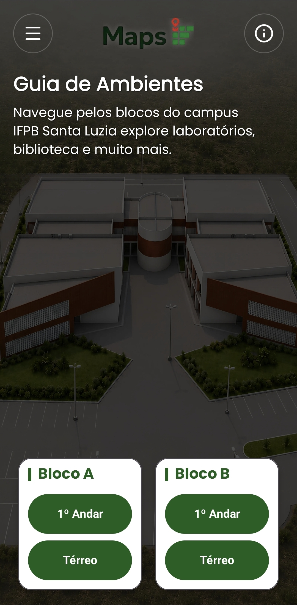

# MapsIF - Guia Interativo do IFPB Santa Luzia

<p align="center">
  
</p>

<p align="center">
  <b>Conheça o campus do IFPB Santa Luzia em 360°, direto do celular.</b>
</p>

<p align="center">
  <a href="https://macedo-hub.github.io/mapsif/"><b>Acessar o site</b></a> ·
  <a href="https://github.com/macedo-hub/mapsif/releases/latest/download/mapsif.apk"><b>Baixar o APK</b></a> ·
  <a href="https://macedo-hub.github.io/mapsif/pages/como-instalar.html"><b>Como instalar</b></a>
</p>

<p align="center">
  
  
  
</p>

---

## Sobre o projeto

O **MapsIF** é um aplicativo Android que permite explorar o campus do IFPB Santa Luzia por meio de um tour virtual 360°. Você escolhe o bloco e o andar, toca no ambiente que quer conhecer e entra nele pelo celular.

Foi desenvolvido como Projeto de Conclusão do Curso Técnico de Informática do IFPB Santa Luzia (turma 2024-2026) e **foi exposto na Semana da Tecnologia do IFPB Santa Luzia**.

## Demonstração

<p align="center">
  
  <br>
  <em>Menu com navegação por blocos e andares</em>
</p>

<p align="center">
  
  <br>
  <em>Navegação em ambiente virtual interativo</em>
</p>

<p align="center">
  
  <br>
  <em>Seção com informações da equipe</em>
</p>

## Como instalar

1. [Baixe o APK](https://github.com/macedo-hub/mapsif/releases/latest/download/mapsif.apk) pelo celular Android (versão 8.0 ou superior).
2. Abra o arquivo e, se o Android pedir, permita a instalação de apps desta fonte.
3. Toque em **Instalar** (se o Play Protect avisar, escolha *Instalar mesmo assim*).
4. Abra o MapsIF e comece a explorar.

Passo a passo com imagens: [página de instalação](https://macedo-hub.github.io/mapsif/pages/como-instalar.html). Todas as versões ficam na página de [Releases](https://github.com/macedo-hub/mapsif/releases).

## Para desenvolvedores

Clone o repositório e gere o APK de debug:

```bash
git clone https://github.com/macedo-hub/mapsif.git
cd mapsif
./gradlew assembleDebug  # Gera o APK de debug
```

## Tecnologias

- **Java** com Android SDK 37 (mínimo: SDK 26, Android 8.0)
- **Pannellum** - visualização 360° via WebView
- **Material Design Components**
- **Lucide Icons** - ícones
- **Glide** - carregamento eficiente de imagens
- **Gradle Version Catalog** - gerenciamento de dependências

## Sobre o site

O [site do MapsIF](https://macedo-hub.github.io/mapsif/) tem fins educacionais: mostrar na prática como é o aplicativo e ensinar a baixá-lo e usá-lo. Nele você encontra:

- Informações sobre o projeto e sua equipe
- Demonstração do tour virtual 360°
- Instruções para download e instalação do APK
- Detalhes sobre as tecnologias utilizadas

## Equipe

| Nome | Função |
| --- | --- |
| **Lucas Emanuel Nóbrega de Macêdo** | Desenvolvimento Android |
| **Iasmim Anahí Alves Silva** | Desenvolvimento Android e UI/UX |
| **Prof. Dr. Antonio Alexandre Moura Costa** | Orientador |
